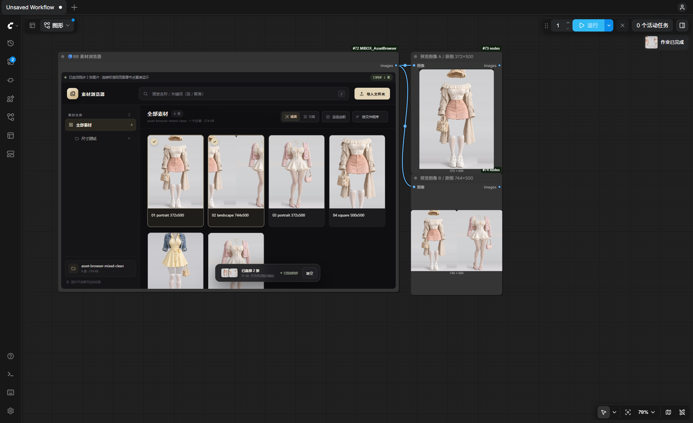

# huan 素材浏览器

把本地图片素材浏览器嵌入 ComfyUI 节点，按文件夹分类浏览、多选图片，然后从一个 `IMAGE` 输出口输出为 batch。

不需要额外点击「应用到节点」：选择图片后会自动同步。可以直接使用 ComfyUI 自带的 **预览图像 / Preview Image** 节点；多个预览图像节点连接到同一个输出口时，会自动分别显示不同图片，并保持每张原图的尺寸和宽高比。



## 兼容性

| 项目 | 支持范围 |
| --- | --- |
| 操作系统 | Windows / Linux / macOS（同一份代码，无平台分支安装步骤） |
| Python | 3.10 ~ 3.13（路径 / 编码逻辑已用 3.13 跑过自检；3.12 用到的 API 完全一致） |
| ComfyUI | 0.3.x 经典节点 API（含 0.3.41）；`PreviewImage` 位置或签名变化会自动适配 |
| 额外依赖 | 无，只用 ComfyUI 自带的 `torch`、`numpy`、`Pillow`、`aiohttp` |
| 浏览器 | 任意现代浏览器可浏览/导入；**实时监听文件夹** 需要 Chrome / Edge + HTTPS（或 localhost） |

Linux 相关的实现细节：

- 文件名按 **UTF-8 字节数** 截断（`NAME_MAX`，通常 255 字节）。中文名在 Windows 上按字符算够用，在 Linux 上会触发 `ENAMETOOLONG`，这里已修正。
- 路径校验使用 `realpath` + `commonpath`，同时兼容符号链接和 Windows 跨盘符；`input` 目录被软链接到别的分区也能正常工作。
- 新建的上传目录强制 `0755`、文件强制 `0644`，避免 Docker / systemd 下 umask 过严导致图片读不到。
- 路径分隔符统一存成 `/`，会话目录名只用 ASCII（`20260101_000000_ab12cd34`），跨平台可直接复制。
- 自动分图补丁在运行时查找 `PreviewImage`（`nodes` / `comfy_extras.*`），并按实际函数签名传参，ComfyUI 小版本升级不会因参数变化报错。

## 安装

把整个 `huan_AssetBrowser` 文件夹放到 ComfyUI 的 `custom_nodes` 目录：

```
ComfyUI/custom_nodes/huan_AssetBrowser
```

Windows（PowerShell）：

```powershell
cd D:\ComfyUI\custom_nodes
git clone https://github.com/2024Xiongmao/ComfyUI-huan-AssetBrowser.git huan_AssetBrowser
```

Linux / macOS：

```bash
cd /path/to/ComfyUI/custom_nodes
git clone https://github.com/2024Xiongmao/ComfyUI-huan-AssetBrowser.git huan_AssetBrowser
# 如果 ComfyUI 在虚拟环境里运行，确认用同一个解释器
source /path/to/ComfyUI/venv/bin/activate   # 可选
python -c "import torch, numpy, PIL; print('deps ok')"
```

然后完全关闭并重启 ComfyUI，浏览器端按 `Ctrl + F5` 强制刷新一次。

无需额外 pip 依赖，使用 ComfyUI 自带的 `torch`、`numpy`、`Pillow`。

> Linux 上如果 ComfyUI 以别的用户/服务运行（systemd、Docker），确保 `ComfyUI/input` 对该用户可写，例如：
> `sudo chown -R comfy:comfy /path/to/ComfyUI/input`。目录不可写时节点状态栏会显示具体错误。

## 使用

1. 在节点菜单搜索「素材浏览器」或 `huan`，添加 **huan_素材浏览器**。
2. 点击内嵌页面里的「导入文件夹」，或把文件夹拖进去。
3. 子文件夹会自动成为分类树；点击图片选择，`Ctrl / ⌘` 多选，`Shift` 连选。
4. 选好后会自动同步。节点状态栏显示「已自动同步 N 张」即可。
5. 把素材浏览器的唯一输出口 `images` 连接到 **ComfyUI 自带的预览图像** 节点（或任何图像处理节点），直接运行。

### 实时监听文件夹（新图自动出现）

不想每次加图都重新导入？点顶部的 **「监听文件夹」** 选一次目录，之后往这个文件夹里放图，浏览器会自动出现，节点也会自动跟上。

- 需要 **Chrome / Edge**，并且通过 **HTTPS 或 localhost** 打开 ComfyUI（浏览器的 File System Access API 限制）。`http://服务器IP:8188` 这种访问方式用不了，按钮会提示。
- 首次选择要授权读取该文件夹；句柄存在浏览器 IndexedDB 里，重开页面会自动恢复监听。浏览器重启后可能需要在按钮上再点一次「恢复监听」重新授权。
- 轮询间隔 3 秒起，扫描变慢时自动放宽到最多 12 秒；标签页切到后台时暂停扫描。
- 变化处理：
  - **新增图片** → 直接出现在分类树里。如果之前是「全选当前」状态，新图会自动加入选择并自动同步到节点。
  - **替换/改动图片**（大小或修改时间变化）→ 保留原来的选择状态，重新上传这一张。
  - **删除图片** → 从列表和选择里一起移除。
- 同步是**增量**的：没改动的图片不会重复上传，只传新增或改动过的文件。第一次同步 300 张、之后加 1 张，就只传那 1 张。
- 点「导入文件夹」会退出监听模式，回到一次性导入（拖拽导入同理）。

> 为什么必须监听本机目录：ComfyUI 跑在云端时，服务器读不到你电脑上的路径，所以监听发生在浏览器侧，发现变化后再把新增文件上传到 ComfyUI 的 `input` 目录。

### 逐张运行（每张图各跑一次工作流）

节点顶部状态栏右侧有个 **「逐张」** 开关。点亮后再点「运行」，会按素材顺序把每张图**单独**提交成一个任务——队列里会看到 N 个任务，ComfyUI 一张一张跑完整工作流，每张各自出图。

适用场景：下游节点只处理 batch 的第一帧（换脸、放大、局部重绘、抠图之类，经常只出一张结果）。这时候选 6 张却只看到 1 张，就是 batch 被截断了，开「逐张」即可。

- **关闭（默认）**：保持原行为，N 张作为一个 `IMAGE` batch 一次跑完，节点输出 `batch size = N`。
- **开启**：节点每次输出 `batch size = 1`，工作流整体跑 N 次，结果按顺序依次产出。
- 开关状态存在节点属性里，随工作流一起保存，重开还在。
- 提交是「排队」而不是「等上一张跑完再提交」：N 个任务会立刻进入队列，然后按顺序执行，中途可以在队列面板取消剩余任务。
- 某个任务校验失败时会停止后续提交，并恢复节点里完整的图片列表。
- 只选了 1 张图时，等同于普通运行。
- 多个素材浏览器节点同时开「逐张」时，以图片最多的那个为准，其余节点按取模方式轮转。

### 续跑（跑完已有的，自动接着跑新放进来的）

配合「监听文件夹」用：点亮 **「续跑」** 后点一次「运行」，节点就进入**常驻排队**状态。

- 一次只提交一张，**等这张真正跑完**才提交下一张，所以中途新增的图片有时间插进队列。
- 队列跑空后不会退出，而是停在「续跑待机 · 已完成 N 张 · 等新图片放进来」。这时往监听的文件夹里丢图 → 自动选中 → 自动同步 → 自动接着跑，不需要再点运行。
- 状态栏实时显示 `续跑中 3/12 · 文件名`、`待跑 N`；素材库缩略图上会标「运行中 / 已跑」。
- 点 **「停止」** 结束续跑（当前这张会跑完，不会中断）；再点运行会重新从头跑一遍当前选中的图片。
- 续跑依赖「逐张」，点「续跑」会自动把「逐张」也点亮。
- 中途又点「运行」不会重复起一轮，只会把当前新选中的图片补进队列。
- 判断「这张跑完了」用的是 ComfyUI 的 `/history`；拿不到 `prompt_id` 的老版本会退回看队列剩余数。

> 注意：续跑是一个**常驻**的排队状态，页面不关就一直等。不想继续等就点「停止」。
>
> 新图没被跑？依次确认：① 开着「监听文件夹」（一次性导入不会发现新文件）；② 节点状态栏是「续跑待机」而不是「续跑结束」（结束了说明点过「停止」或任务被取消）；③ 标签页在后台时监听会暂停扫描，切回前台几秒内会补上。

### 多个标准预览节点显示不同图片

1. 添加 **两个或更多** ComfyUI 自带的「预览图像」节点。
2. 把它们都连接到素材浏览器同一个 `images` 输出口。
3. 直接运行队列。每个预览图像节点会按节点创建顺序（节点 ID 顺序）自动取不同的一帧：
   - 第 1 个预览 → 第 1 张
   - 第 2 个预览 → 第 2 张
   - 如果预览节点数量超过图片数量，会从第 1 张开始循环。
4. 如果只连接 **一个** 标准预览节点，ComfyUI 保持默认行为，会在该节点中显示整个 batch。

> 为什么可以这样：ComfyUI 的一条连线传递的是同一份 batch。插件只针对「输入来自 huan 素材浏览器，并且同一输出口连接了多个标准 PreviewImage」这种情况，对标准预览节点的取帧逻辑做了一个很窄的扩展。每个预览节点会直接读取自己对应的原始上传文件，因此预览图保留原始尺寸和宽高比；仍然使用 ComfyUI 原生预览节点和原生预览界面。
>
> 其他来源的 PreviewImage，以及只连接一个预览节点的情况，都保持 ComfyUI 原本行为。

示例工作流可直接拖入 ComfyUI：

```
example_workflow.json
```

里面是一个素材浏览器 + 两个标准「预览图像」节点，连接好后直接运行即可。

## 性能说明

素材浏览器以 iframe 嵌入节点。ComfyUI 缩放/平移画布时会缩放整个 iframe，因此模板里已经针对嵌入模式减少重绘开销：

- 关闭卡片阴影和 hover 位移动画。
- 关闭缩略图 shimmer 动画。
- 关闭选择栏、提示浮层等元素的 `backdrop-filter`。
- **不会在缩放/移动时隐藏或暂停素材浏览器**，内容始终可见。

如果超大目录（数千张图且已经滚动加载了很多页）下仍感觉缩放卡顿，可以缩小节点、减少同时浏览的图片数量，或反馈给我继续做渲染分页/虚拟列表。

## 自动同步

- 不再有「应用到节点」按钮。
- 选择图片后会自动把图片写入 `ComfyUI/input/huan_asset_browser/<会话>/`，并更新节点数据。
- 如果选完图片立刻点「运行」，插件会让队列等自动同步完成后再提交，避免预览拿到旧图。
- 预览节点使用的是标准 ComfyUI 预览节点，不存在额外的「分图预览」自定义节点。

同步状态：

- `未同步`：还没选图片，或选完被清空。
- `正在自动同步…`：正在写入 ComfyUI 的本地 input 目录。
- `已自动同步 N 张`：可以运行。
- `失败`：后台或图片格式问题，节点内会显示错误。

## 输出与尺寸

- 输出始终只有一个 `IMAGE` 口，选中 N 张就是 batch size = N。
- 多个标准预览节点会直接显示各自的原图文件，因此预览图可以保留不同的原始尺寸和宽高比（例如 372×500 和 744×500）。
- 唯一 `IMAGE` 输出本身仍必须是规整的 tensor batch，所以发给下游节点的 batch 会保持原比例、居中填充到最大宽高（黑色填充）。预览显示的是原图尺寸；下游处理节点收到的是统一尺寸的 batch。这是 ComfyUI `IMAGE` batch 的格式限制。
- 图片按素材浏览器里的文件路径顺序输出，不按点击顺序。
- 单次最多同步 **300 张**图片。批次很大时注意显存/内存。

## 工作流持久化

- 同步后的图片路径保存在隐藏的 `images_data` widget 中，随工作流一起保存。
- 图片文件保存在 `ComfyUI/input/huan_asset_browser/<会话>/`。重新打开工作流或重启 ComfyUI 后，只要文件还在，节点仍可执行。
- 更换电脑或分享工作流时不会自动携带 input 文件；需要在目标机器重新选择图片。
- 每次上传时会清理超过 30 天的旧会话目录。
- 页面刷新或重启后，内嵌浏览器不会保留上次的素材选择；节点里已经同步好的结果会保留。

## 嵌入实现

实现方式（iframe 嵌入 + postMessage 同步）：

```
nodes.py                 Python 节点、上传路由、图片 batch、PreviewImage 窄范围扩展
__init__.py              注册 NODE_CLASS_MAPPINGS、WEB_DIRECTORY
web/js/asset_browser.js  addDOMWidget + iframe + 自动同步 + 队列等待 + 预览节点分图
web/asset_browser.html   原素材浏览器 HTML（?embed=1 时自动同步到节点）
example_workflow.json    示例工作流
docs/usage.png           使用效果图
```

流程：

1. `WEB_DIRECTORY = "./web"` 把前端文件暴露到 `/extensions/huan_AssetBrowser/`。
2. `addDOMWidget()` 把 iframe 放进节点。
3. iframe 内的素材浏览器在选中图片后通过 `postMessage` 把 `File` 对象发给父页面。
4. 父页面把文件 POST 到 `/huan_asset_browser/upload`，保存到 ComfyUI 的 `input` 目录。
5. 文件路径写入隐藏的 `images_data` widget。
6. Python 节点读取 `images_data`，加载图片，统一 padding 后返回一个 `IMAGE` batch。
7. 用户直接运行时，队列钩子会等待同步完成，再提交工作流。
8. 标准 `PreviewImage` 在检测到「输入来自 huan 且同一输出有多个 PreviewImage」时，按自身节点 ID 顺序取对应的一帧保存；否则完全走 ComfyUI 原逻辑。

## 常见问题

**节点里没有出现素材浏览器，只有一条状态栏？**

检查浏览器控制台是否加载失败：

```
/extensions/huan_AssetBrowser/asset_browser.html
/extensions/huan_AssetBrowser/js/asset_browser.js
```

重启 ComfyUI 后按 `Ctrl + F5` 清理前端缓存。

**两个预览图像节点显示的还是同一整批图片**

- 确认两个节点都是 ComfyUI 自带的「预览图像 / Preview Image」。
- 确认两个节点的 `IMAGE` 输入都直接连接到素材浏览器的同一个 `images` 输出口。
- 确认预览节点数量至少为 2；只连 1 个时 ComfyUI 默认展示整批。
- 自动分图按节点 ID，不按画布位置；如果节点被绕过/禁用，可能导致实际参与运行的预览数量变化。

**点击运行后没有立即开始**

队列正在等待自动同步完成（通常只有短暂时间）。状态栏显示「已自动同步 N 张」后就会提交。

**自动同步失败**

- 图片必须是 Pillow 能读取的栅格图片，例如 JPG、PNG、WEBP、BMP、GIF。SVG、部分 HEIC 图片无法用于节点输出。
- 单次最多 300 张。
- 查看 ComfyUI 控制台是否有 `[huan AssetBrowser] upload error`。

**运行时报“请先在节点内选择图片”**

内嵌素材浏览器里还没有选择图片，或刚清空了选择。选中图片后等状态变为「已自动同步 N 张」。

**后端日志出现 `route already registered` / 「上传路由已存在，跳过重复注册」**

`custom_nodes` 里有重复的插件副本（例如既放了 `huan_AssetBrowser/nodes.py`，又单独丢了一份 `nodes.py` 进去），同一路由被注册两遍。删掉多余的那份，只保留 `custom_nodes/huan_AssetBrowser/` 整个文件夹即可。

当前版本已做幂等保护：即使还有重复副本，也只打印一行提示，不会让 ComfyUI 启动失败。

**点了「监听文件夹」没反应，或者提示需要 HTTPS**

`showDirectoryPicker` 只在安全上下文可用。用 `http://IP:8188` 访问时浏览器直接不提供这个 API。解决办法：给 ComfyUI 套一层 HTTPS 反向代理（Caddy / Nginx + 证书，或 Cloudflare Tunnel），或者改用「导入文件夹」。

**监听开着，但新图没出现**

- 确认浏览器标签页没有被切到后台（后台会暂停轮询）。
- 确认文件确实落在这个被监听的目录（含子目录）里，且是 Pillow 能读的栅格图。
- 大目录首次扫描较慢，轮询间隔会自动放宽到最多 12 秒，稍等一下。
- 权限被系统回收（例如浏览器重启）时，按钮会变成「恢复监听」，点一次重新授权即可。

## Linux / macOS 常见问题

**提示 `无法访问 ComfyUI 输入目录 ... Permission denied`**

ComfyUI 进程对 `input` 目录没有写权限。检查运行用户：

```bash
ls -ld /path/to/ComfyUI/input
id -un                     # 当前 ComfyUI 进程的用户
sudo chown -R $(id -un) /path/to/ComfyUI/input
```

Docker 部署时把宿主目录挂载进来并保持同一 UID/GID，或用 `chmod g+w` 配合同组用户。

**同步时报 `OSError: [Errno 36] File name too long`**

已修复：文件名按 UTF-8 字节数截断到 `NAME_MAX`（一般 255 字节），保留扩展名。若仍出现，说明挂载的文件系统（如某些 NAS / eCryptfs）`NAME_MAX` 更小，插件会自动读取 `PC_NAME_MAX` 并适配。

**一次选很多图时提示“单次同步体积超过 ComfyUI 上传上限”**

ComfyUI 的 aiohttp 应用有请求体上限，默认 100MB（`--max-upload-size`，单位 MB）。两种办法：

```bash
python main.py --max-upload-size 512
```

或者一次少选一些图（单次最多 300 张）。

**Linux 上中文文件名变问号 / 方块**

界面字体缺 CJK 回退。安装任意一款中文字体即可，例如：

```bash
sudo apt install fonts-noto-cjk        # Debian / Ubuntu
sudo dnf install google-noto-sans-cjk-fonts   # Fedora
```

插件已把 `Noto Sans CJK SC`、`Source Han Sans SC`、`WenQuanYi Micro Hei` 加入字体栈。

**ComfyUI 跑在远程服务器上，浏览器打不开素材浏览器**

插件只通过 `WEB_DIRECTORY` 提供静态文件，没有额外端口。确认访问的是 ComfyUI 自己的地址（含反向代理前缀），并允许 iframe 同源加载；若用 Nginx 反向代理，不要给 `/extensions/` 加 `X-Frame-Options: DENY`。

**Linux 上重启后日志出现 `PreviewImage 未找到` 或“跳过预览分图补丁”**

说明当前 ComfyUI 版本把 `PreviewImage` 换成了新的节点定义方式。素材浏览器、上传、`IMAGE` 输出都正常，只有“多个预览节点自动分图”不可用。
